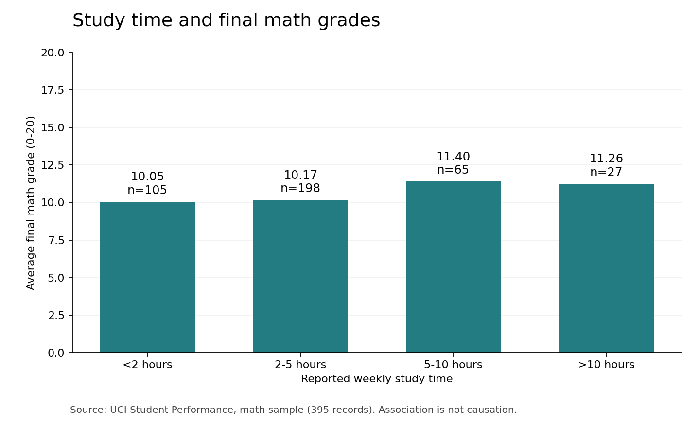

# Student Performance: A First Data Analysis

A small Python project exploring study time and final math grades in a public student dataset.

I'm a BIS student and aspiring full-stack developer. This is an assisted learning project for practicing Python, pandas and charts. The starter code and analysis were prepared with AI assistance. This is descriptive analysis, not a prediction model.

## Questions

- How do average final math grades differ across reported weekly study-time groups?
- How do grades differ between students with and without recorded past class failures?

## Results in this sample

| Weekly study time | Students | Average final grade / 20 |
| --- | ---: | ---: |
| Under 2 hours | 105 | 10.05 |
| 2-5 hours | 198 | 10.17 |
| 5-10 hours | 65 | 11.40 |
| Over 10 hours | 27 | 11.26 |



The 5-10 hour group has the highest average, but the over-10-hour group is slightly lower. The groups also have very different sizes. This is not evidence that a particular amount of study causes a grade change.

Students with no recorded past class failures average **11.25/20** (312 records), compared with **7.27/20** for students with at least one recorded past failure (83 records). This is an association, not an explanation of an individual student's result.

## What the code does

1. Loads the semicolon-separated math CSV.
2. Checks key columns, missing values and valid ranges. Reports duplicate rows without automatically deleting them.
3. Uses `groupby` to calculate group sizes and average grades.
4. Exports two summary CSVs and one labeled bar chart.

## Run without installing anything

Use **Google Colab** with a Google account:

1. Open [Google Colab](https://colab.research.google.com/).
2. Choose **File > Upload notebook**, then select `analysis.ipynb`.
3. Run the code cells from top to bottom. The notebook downloads the public CSV automatically if it is not already present.

The notebook is standalone. It does not need `analysis.py` uploaded beside it, a Drive connection, an API key or a paid runtime. Downloading the data needs internet access. If the source is temporarily unavailable, upload the included `student-mat.csv` through Colab's Files panel and rerun the loading cell.

Optional local run with Python 3.10+:

```text
pip install -r requirements.txt
python analysis.py
```

## Files

- `analysis.ipynb`: explained, runnable notebook with saved example outputs.
- `analysis.py`: the same analysis as a Python script.
- `student-mat.csv`: unchanged source math data, included for reproducibility.
- `study_summary.csv`, `failure_summary.csv`: calculated results.
- `study_time.png`: exported chart.
- `requirements.txt`: packages for a local run.
- `DATA_SOURCE.md`: citation, license and checksum.

## Data and limits

Source: [UCI Student Performance](https://archive.ics.uci.edu/dataset/320/student+performance), credited to Paulo Cortez (2008), [DOI: 10.24432/C5TG7T](https://doi.org/10.24432/C5TG7T). The data is licensed under [CC BY 4.0](https://creativecommons.org/licenses/by/4.0/).

This project uses **only `student-mat.csv`: 395 math-course records and 33 columns**, not the 649-record Portuguese-language file. The data comes from two Portuguese secondary schools. It is historical data, not a sample of Egyptian university students. `G3` is the final grade on a 0-20 scale. `studytime` is an ordered category, not an exact number of hours. No rows are removed or imputed. There are no missing cells or exact duplicate rows in the included file.

The comparisons are unadjusted group averages. Other factors may explain the differences, and no significance test or causal analysis is included. Zero final grades are retained. The original dataset is not mine; the summary tables and chart are derived from it.

## Next step

Add a median-grade comparison and explain whether it changes the story. Before presenting this project in an interview, I need to be able to explain each code cell and the limits above.
